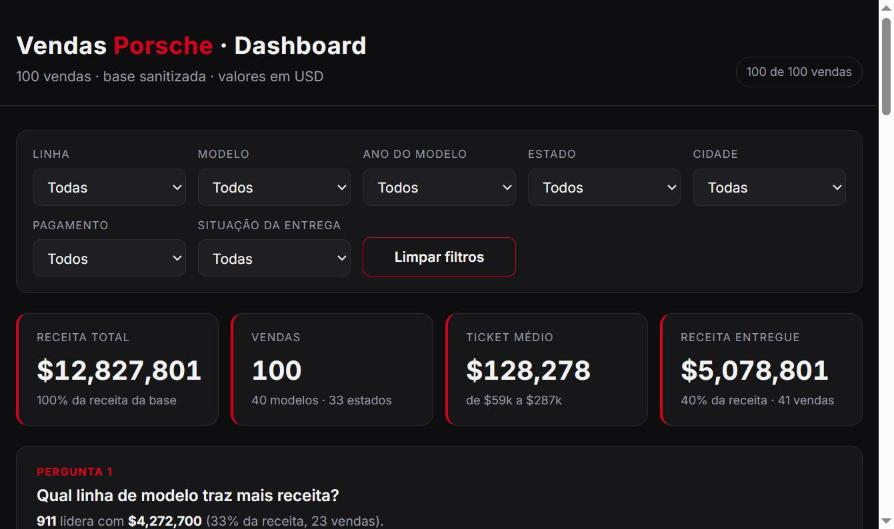
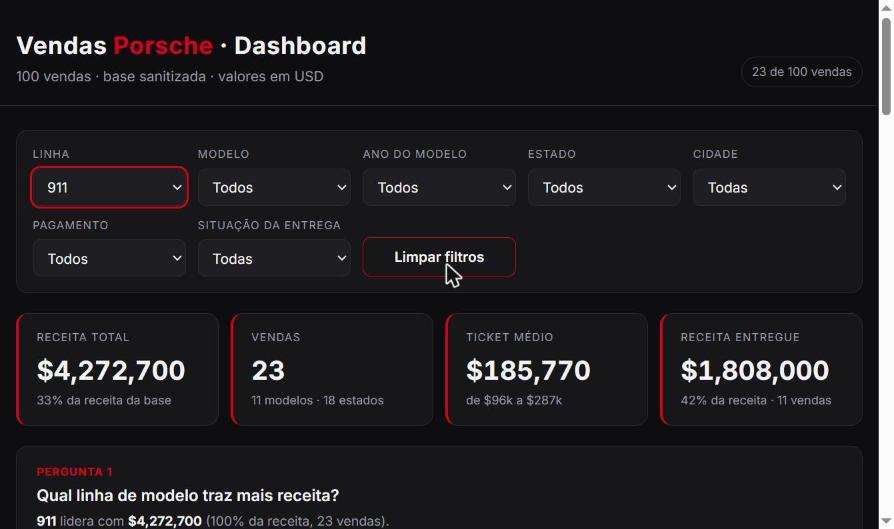

# Dashboard de Vendas Porsche

Dashboard interativa em HTML (arquivo único) feita a partir de uma planilha de 100 vendas da Porsche, publicada no GitHub Pages.

**🔗 Dashboard publicada:** https://conceicaofrancisco645-commits.github.io/dashboard-porsche-sales/



---

## Perguntas de negócio

| # | Pergunta | Como é respondida | Por que escolhi |
|---|----------|-------------------|-----------------|
| 1 | **Qual linha de modelo traz mais receita?** | Barras horizontais de receita por linha (911, Cayenne, Macan, Taycan, Panamera, 718), com a líder destacada | Mostra onde está o dinheiro do portfólio e ajuda a decidir em qual linha concentrar estoque e esforço comercial. |
| 2 | **Como os clientes pagam, e quanto dinheiro passa por cada método?** | Barras de receita por método de pagamento com uma linha de quantidade de vendas sobreposta | O método mais usado nem sempre é o que movimenta mais dinheiro. Isso importa para negociar taxas, financiamento e leasing. |
| 3 | **Quais estados concentram a receita?** | Top 10 estados por receita, com os 3 maiores destacados | Indica para onde direcionar marketing, logística de entrega e expansão. |

Além delas, um gráfico de apoio mostra **quanto da receita já foi entregue**, quanto está em andamento e quanto foi cancelado.

Cada gráfico tem uma frase-resposta que se recalcula a cada filtro, por exemplo: *"911 lidera com $4.272.700 (33% da receita)"*.

### Indicadores de topo
Receita total · Número de vendas · Ticket médio (com faixa mín–máx) · Receita entregue.

### Filtros
Linha · Modelo · Ano do modelo · Estado · Cidade · Método de pagamento · Situação da entrega. Os filtros são **dependentes**: cada lista só mostra opções que existem no recorte atual. Ao escolher o estado CA, por exemplo, a lista de cidades passa a mostrar só cidades da Califórnia.

### Exemplo de filtro aplicado (Linha = 911)


Com o filtro, as 23 vendas da linha 911 somam $4,27M (33% da receita total). O ticket médio sobe para cerca de $186 mil, e Wire Transfer é o método dominante.

---

## Tratamento da base antes de ir para a IA

A planilha original traz cada campo em duas versões: o dado **cru** e o **sanitizado**. Antes de montar a dashboard:

1. **Fiquei só com as colunas sanitizadas**: data, modelo, ano, preço, quilometragem, pagamento, cidade, estado e status de entrega.
2. **Converti preço e ano em número.** No cru vinham valores como `$121k`, `USD 112.750`, `68.900 dollars` e `twenty twenty four`; na versão final são números puros.
3. **Removi dados pessoais.** `customer_name` (nome do cliente) e `salesperson` (vendedor) **não entram** no HTML, porque a base fica embutida na página pública.
4. **Datas inválidas** (24 registros, como `2024-02-30` e `April 31st`) ficaram marcadas como `INVALID` na sanitização. Elas aparecem como "inválida" na tabela, mas **a venda continua contando** nos indicadores, já que preço, modelo e local são válidos.
5. **Criei a coluna derivada "Linha"** a partir do modelo (ex.: `911 Turbo S` → `911`), para a pergunta 1 não se perder em 40 modelos diferentes.
6. **Agrupei o status de entrega** (10 valores) em 3 situações: *Entregue*, *Em andamento* (Pending, In Transit, Shipped, Awaiting…) e *Cancelado*.

A base tratada está em [`porsche_sanitizada.csv`](porsche_sanitizada.csv).

---

## Ferramenta usada

Usei um **agente de IA com skill de dashboard** (Claude), em vez do ChatGPT com Canvas. O agente leu a planilha, tratou a base, gerou o HTML, testou a página num navegador headless (com um print aplicando filtro) e publicou no GitHub.

## O prompt

Prompt-base:

> Crie uma dashboard em HTML, arquivo único, com Chart.js, a partir desta planilha de 100 vendas da Porsche. Use só as colunas sanitizadas e não inclua nome de cliente nem de vendedor.
> Responda três perguntas de negócio, cada uma com um gráfico e uma frase de resposta que se atualize com os filtros:
> 1. Qual linha de modelo traz mais receita?
> 2. Como os clientes pagam, e quanto dinheiro passa por cada método?
> 3. Quais estados concentram a receita?
> Inclua KPIs no topo (receita total, vendas, ticket médio, receita entregue) e filtros por linha, modelo, ano, estado, cidade, pagamento e situação da entrega.
> Visual: fundo escuro, vermelho como cor de destaque e dourado como secundária, fonte Inter.

### O que mudou até a versão final
- **Pergunta 2:** a primeira versão mostrava só a quantidade de vendas por método. Acrescentei a receita (barras) e deixei a quantidade como linha, porque o método mais frequente e o que movimenta mais dinheiro podem ser diferentes.
- **Filtros dependentes:** pedi que cada lista mostrasse apenas opções válidas no recorte, para evitar combinações vazias.
- **Frases-resposta dinâmicas:** além do gráfico, cada pergunta ganhou uma frase com o número-chave, para quem não quer ler o gráfico.
- **Gráfico de apoio de entrega e tabela de detalhe**, para permitir conferir os números venda a venda.
- **Estado vazio:** se nenhuma venda bate com os filtros, a página avisa em vez de quebrar.

---

## Estrutura do repositório

```
index.html               # dashboard (dados embutidos, Chart.js via CDN)
porsche_sanitizada.csv   # base tratada usada na dashboard
print-dashboard.png      # print da dashboard completa
print-filtro-911.png     # print com filtro aplicado
README.md
```

## Como rodar localmente
Basta abrir o `index.html` no navegador (é preciso internet para carregar o Chart.js e a fonte).

## Ideias para evoluir
- Trocar o filtro de cidade por um mapa por estado.
- Escrever uma regra para recuperar as 24 datas `INVALID` a partir do dado cru.
- Criar uma versão no estilo dos componentes do Power BI.
